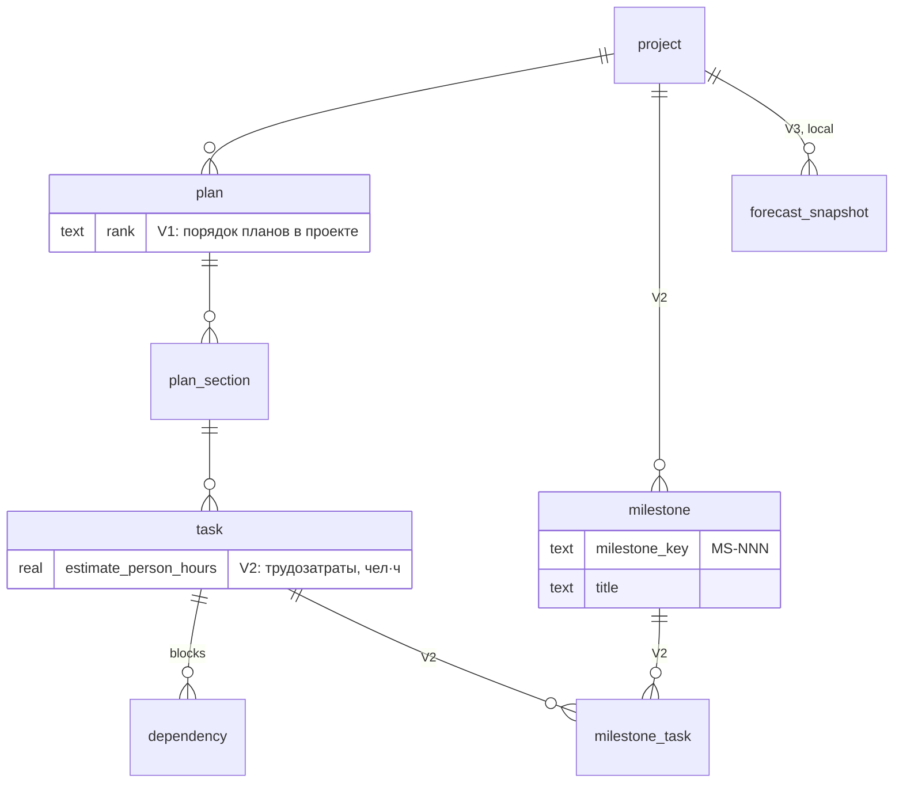

# 36 — Планировщик дорожной карты: порядок работ и прогноз во времени

> **Статус: 🟢 реализован V1 + V2 (2026-10-27)** — план `roadmap-2026-10`:
> секции A–D 9/9 `done` (PR #267), ROAD-009/010 `done` (PR #269); открыта
> ROAD-011 (вехи, по условию §4). Аудит —
> [2026-10-27-roadmap-sections-a-d.md](../docs/system/audit/2026-10-27-roadmap-sections-a-d.md).
>
> Категория: 🔵 Архитектура · Риск: средний · Зависимости: `plan_service.graph`
> и `audit._find_cycles` (граф, циклы), `infra/ordering` (ранг, RFC 29 §3.2),
> FLW-003 (длительности работы — только для V2), ADO-137 (фактический Гант —
> входит в план этого RFC).
> Источник — черновик «26 — Планировщик дорожной карты» от 2026-09-20
> (worktree `roadmap-planner-rfc`, не коммитился; номер 26 с тех пор занят
> реализованной «Правкой графа плана») и его разбор с владельцем 2026-10-24.


## 1. Контекст

Запрос владельца (2026-09-20, уточнён 2026-10-24): экран дорожной карты —
диаграмма Ганта, по которой владелец и разработчики видят, **в каком порядке**
делать планы и фичи, и **примерно когда** очередь дойдёт до каждой.

Уточнение 2026-10-24 задаёт смысл дат: «разработка быстрая, но не мгновенная —
это планирование времени, а не дедлайны; даты могут быть, но они ничего не
значат». Отсюда граница с решением владельца 2026-08-30 (ROADMAP M4: «код
пишет AI-агент, поэтому окна/сроки не планируются; спринт = упорядоченная
очередь с критерием выхода»). Этот RFC его не отменяет, а опирается на него:

- **контракт — порядок**: очередь задаёт человек, движок её только раскладывает;
- **дата — прогноз**: вычисляется на запрос из порядка и истории проекта,
  нигде не хранится и ни к чему не обязывает. Дедлайнов, окон и сроков в
  модели нет.

Черновик от 09-20 строил расписание на длительностях задач (оценки + медиана
времени цикла по типу). Проверка на БД 2026-10-24 показала, что
откалибровать длительности сейчас нечем (§2, T6–T7), а прогноз по
пропускной способности не требует ни оценок, ни календаря. Поэтому V1 — порядок
+ прогноз по пропускной способности; длительности задач — V2, после FLW-003.


## 2. Текущее состояние (проверено по коду и БД 2026-10-24)

| # | Факт | Где |
|---|---|---|
| T1 | У плана нет порядка: `PlanModel` без `RankMixin`, тогда как у секций ранг есть. Порядок планов живёт прозой в ROADMAP (очереди M4/M5) | `cod_doc/infra/models/plans.py:22`, `:60`; `docs/system/roadmap/ROADMAP.md:454` |
| T2 | Граф строится внутри одного плана: `chain_layout`, `critical_path`, `forward/reverse_chain` не видят рёбер между планами, хотя `task_service.create` их штатно создаёт | `cod_doc/services/plan_service/graph.py:197-202`; `cod_doc/services/task_service.py:1312` |
| T3 | `ready_tasks` (view) глобален и межплановые рёбра учитывает — расхождение с `chain_layout` описано в его docstring | `graph.py:197-202` |
| T4 | `_find_cycles` принимает смежность по `row_id` и от плана не зависит — годится для графа всего проекта | `cod_doc/services/plan_service/audit.py:20` |
| T5 | Снимок 2026-10-19: рёбер `blocks` 276, из них между планами 6; открытых задач 155, у 49 есть хотя бы одно ребро. Порядок в основном задаётся порядком планов и секций, а не рёбрами | `.cod-doc/state.db` ноутбука (SoT на Гермесе, снимок отстаёт на 5 дней) |
| T6 | `checked_out_at` пуст у **всех** закрытых задач (очищается при release), `task_metrics.in_progress_hours` пуст у всех строк (F1 RFC 33, FLW-003 `todo`). Время работы над задачей не восстановить | снимок 2026-10-19; `proposals/33-flow-attention-quality-budget.md` F1 |
| T7 | Есть только lead time (`created → completed_at`), и он мерит ожидание в очереди, а не работу: feature 3.15 д, bug 3.61, refactor 1.37, migration 7.13 | снимок 2026-10-19 |
| T8 | Пропускная способность за 8 полных недель (W34…W41, 2026-08-24…10-18): 66, 10, 14, 67, 72, 29, 12, 49 закрытых задач в неделю — разброс в 7 раз, медиана 39; W31–W33 — ноль | снимок 2026-10-19 |
| T9 | `project.config_json` — колонка `local`, между репликами не уезжает: календарь черновика в ней разошёлся бы между ноутбуком и Гермесом | `cod_doc/infra/sync_registry.py:624` |
| T10 | Ранг authored-таблицы объявляется в реестре синхронизации `TableSpec(..., rank_column="rank")` — так у `plan_section` и других упорядоченных таблиц; у `plan` его нет. Не объявленная колонка на другую реплику не уедет | `cod_doc/infra/sync_registry.py:609`, `:651` |
| T11 | Веб — Jinja + htmx + вендоренные mermaid/hljs, шага сборки нет; на странице плана прогресс и mermaid-граф (порядок, не время) | `cod_doc/templates/web/base.html`; `templates/web/project/plan_show.html` |
| T12 | Голова миграций — `0053_sync_access`; новая ревизия будет `0054` | `cod_doc/infra/migrations/versions/` |

Вывод: порядок задач внутри плана есть, порядка планов нет, графа проекта нет,
длительностей нет. Пропускная способность есть — и её достаточно, чтобы
дата на шкале была честным прогнозом, а не выдумкой.


## 3. Предложение

### 3.1. Три слоя, которые нельзя смешивать

| Слой | Что это | Где живёт | Кто пишет |
|---|---|---|---|
| **Факт** | когда задача реально заведена и закрыта | `created`, `completed_at` | система, при мутации задачи |
| **Порядок** | что за чем делать | `plan.rank`, ранг секции, приоритет задачи, рёбра `blocks` | человек, явным действием |
| **Прогноз** | когда очередь примерно дойдёт до задачи | нигде — вычисляется на запрос | движок |

Запрет, который держит тест: **движок ничего не пишет**. Прогноз не
сохраняется ни в задачу, ни в план; смотреть экран нельзя «испортить», а
пересчёт после любой правки порядка бесплатен. Полей-обязательств
(`due_date`, `target_date`, baseline) в модели нет — это и есть «даты ничего
не значат».

### 3.2. Модель данных

Правило модели: в БД хранится только слой «порядок» (§3.1) и то, из чего
прогноз считается; ни одной колонки с плановой датой. Всё, что движок
выдаёт, — значения в памяти (§3.2.5).

#### 3.2.1. Что хранится, по этапам

| Этап | Миграция | Объект | Изменение | Класс синхронизации |
|---|---|---|---|---|
| V1 | 0054 | `plan` | `+ rank TEXT NULL` | authored, `rank_column` |
| V2 | 0055 | `task` | `+ estimate_person_hours REAL NULL` | authored, колонка в `_SHIPPED_BEFORE_UID["task"]` |
| V2 | 0056 | `milestone` | новая таблица | authored, ключ `_leased("milestone_key")` |
| V2 | 0056 | `milestone_task` | новая таблица | authored, `deterministic_uid` |
| V3 | 0057 | `forecast_snapshot` | новая таблица | local |

Номера 0055–0057 — плановые: ревизия берёт следующий свободный номер на
момент мержа. Остальное движок читает из существующих колонок:
`task.status`, `priority`, `plan_id`, `section_id`, `created`,
`completed_at`; `dependency(kind = 'blocks')`; `plan_section.rank`; в V2 —
`task_metrics.in_progress_hours`.



#### 3.2.2. V1 — `plan.rank` (миграция 0054)

- **Колонка.** `ALTER TABLE plan ADD COLUMN rank TEXT` — как у десяти
  таблиц в 0050: правка на месте, без `batch_alter_table`. Пересборка `plan`
  на SQLite унесла бы по CASCADE секции и задачи (тот же механизм, что у
  `document`, §«Миграции» CLAUDE.md). Индекса нет: в проекте ~20 планов, и
  очередь читает их все.
- **Бэкфилл.** В пределах `project_id`, `ORDER BY created, row_id`, ранги —
  застывшая копия `rank.initial(n)` внутри миграции (образец 0050: миграция
  не импортирует `cod_doc.infra.rank`). После upgrade `rank` не пуст ни у
  одной строки.
- **Downgrade.** `ALTER TABLE plan DROP COLUMN rank` (SQLite ≥ 3.35, на месте).
- **ORM.** `PlanModel(RankMixin, SyncUidMixin, Base)`;
  `ordering.PARENTS["plan"] = ("project_id",)`. Новый план получает ранг в
  `before_flush`; позиции у плана нет, поэтому он встаёт **в конец** очереди
  проекта, перестановка — явным `plan_move`.
- **Домен.** `Plan.rank: str | None = None` (`domain/entities.py`).
- **Синхронизация.** `TableSpec("plan", _A, natural_keys=…, rank_column=_RANK)`;
  `SHIPPED_COLUMNS` добавляет ранг сам (`_with_identity_and_rank`). Две
  реплики, переставившие один план, сходятся так же, как при перестановке
  секции.
- **Чтение.** `ordering.order_by(PlanModel)` в `plan_list`, списке планов в
  вебе, `plan_sections_list` без `plan_scope` и в очереди. Закрытые планы
  ранг сохраняют; на экране дорожной карты их нет, пока не включён тумблер
  «история».

#### 3.2.3. V2 — `task.estimate_person_hours` (миграция 0055)

- `ALTER TABLE task ADD COLUMN estimate_person_hours REAL` — на месте, по той
  же причине: на `task` висят `dependency`, `affected_file`, `task_document`.
- **Единица — человеко-часы (чел·ч)**: трудозатраты, а не длительность.
  Задача на 6 чел·ч — шесть часов работы одного исполнителя; исполнитель —
  человек или агент. Длительность из оценки не выводится: сколько
  исполнителей возьмут задачу параллельно, модель не знает и не хранит.
  Дни — слишком грубая сетка: при ИИ-исполнителе задача закрывается за часы.
- Без `CHECK`: `> 0` проверяет сервис (`task_service.set_estimate`), как и
  остальные инварианты задачи. `NULL` = оценки нет — нормальное состояние
  большинства задач.
- Это вес задачи в очереди, а не обязательство: из оценки никакая дата не
  пишется. В прогнозе V2 ёмкость недели — сумма чел·ч задач, закрытых за
  неделю (оценка, а без неё — эмпирика по типу), и очередь расходует её в
  тех же единицах.
- Мутация пишет ревизию `op=estimate` и событие `task.estimate_changed`
  (ADO-040); `Task.estimate_person_hours` в домене; колонка вносится в
  `_SHIPPED_BEFORE_UID["task"]` — иначе она не уезжает.

#### 3.2.4. V2 — вехи (миграция 0056)

Веха нужна там, где «фича пригодна» собирается из задач **нескольких**
планов; один план уже отвечает на этот вопрос сам.

```
milestone
  row_id          INTEGER PK
  uid             TEXT              -- SyncUidMixin
  project_id      INTEGER NOT NULL  -- FK project ON DELETE CASCADE
  milestone_key   TEXT NOT NULL     -- MS-NNN
  title           TEXT NOT NULL
  description     TEXT NULL
  created         DATETIME NOT NULL
  last_updated    DATETIME NOT NULL
  UNIQUE (project_id, milestone_key)

milestone_task
  row_id          INTEGER PK
  uid             TEXT              -- uuid5(milestone_id, task_id)
  milestone_id    INTEGER NOT NULL  -- FK milestone ON DELETE CASCADE
  task_id         INTEGER NOT NULL  -- FK task.row_id ON DELETE CASCADE
  UNIQUE (milestone_id, task_id)
```

- **Нет `target_date`, нет `status`, нет ранга.** Дата вехи — max p50/p85 её
  задач из прогноза; «достигнута» — все задачи `done`/`cancelled`; порядок
  вех на шкале — по выведенной дате. Ни одно из трёх не хранится.
- **Ключ.** `MS-NNN` аренды номеров, как `ADR`/`Q`/`SCN`: `"MS"` в
  `leases._FIXED_PREFIXES`, `"milestone": "milestone"` в `_EVENT_SCOPES` и
  `HUMAN_ID_KINDS`. Без аренды две реплики выдали бы один `MS-004`.
- **Ревизии.** `EntityKind.MILESTONE` — своя нумерация `row_id` (логика
  ADO-143). Привязка и отвязка задачи — ревизии вехи (`op=link_task` /
  `unlink_task`) плюс событие одним вызовом
  `write_revision_and_emit_event`. Не как у `adr_service.link_task`, где
  только событие (`emit_for_write`): состав вехи откатывается
  `revision_revert`.
- **Инварианты сервиса.** Задача и веха из одного проекта; повторная
  привязка — no-op без ревизии.

#### 3.2.5. Что не хранится: типы движка (`cod_doc/domain/roadmap.py`)

Неизменяемые `@dataclass(frozen=True, slots=True)` и `StrEnum` в слое
`domain` — их собирают сервисы, сериализуют `services/serializers.py`, а
MCP, CLI `--json` и REST отдают одну и ту же форму.

```python
class QueueFlag(StrEnum):
    IN_PROGRESS = "in_progress"   # идёт первой
    BLOCKED = "blocked"           # status blocked или blocked_reason
    PULLED = "pulled"             # подтянута ради задачи раньше в очереди
    CROSS_PLAN = "cross_plan"     # есть ребро в другой план
    BACKLOG = "backlog"           # только при include_backlog

class QueueUnit(StrEnum):      TASKS = "tasks" | PERSON_HOURS = "person_hours"   # V2
class DurationSource(StrEnum): EXPLICIT | EMPIRICAL | UNIFORM                     # V2

class QueueRow:      task_id, plan_scope, section_letter, position: int,
                     status: TaskStatus, priority: Priority,
                     pulled_by: tuple[str, ...], flags: frozenset[QueueFlag],
                     weight: float = 1.0, duration_source = UNIFORM        # V2
class PlanBar:       scope, rank, first_position, last_position, open_count
class Queue:         rows: tuple[QueueRow, ...], plans: tuple[PlanBar, ...],
                     unit: QueueUnit = TASKS                                  # V2

class ThroughputWeek: week_start: date, closed: int, created: int,
                      closed_weight: float = 0.0                               # V2, чел·ч

class ForecastWarning(StrEnum):
    INFLOW_EXCEEDS = "inflow_exceeds"   # создано за окно больше, чем закрыто
    SHORT_SAMPLE = "short_sample"       # меньше MIN_SAMPLE_WEEKS
    ZERO_SAMPLE = "zero_sample"         # ни одной закрытой задачи за окно
    BEYOND_HORIZON = "beyond_horizon"   # хвост очереди за HORIZON_WEEKS

class ForecastRow:   task_id, p50: date | None, p85: date | None
class PlanForecast:  scope, p50_start: date | None, p50_finish: date | None,
                     p85_finish: date | None
class Forecast:      asof: date, sample: tuple[ThroughputWeek, ...],
                     rows: tuple[ForecastRow, ...], plans: tuple[PlanForecast, ...],
                     warnings: tuple[ForecastWarning, ...], runs: int, seed: int,
                     unit: QueueUnit = TASKS                                  # V2
class Roadmap:       queue: Queue, forecast: Forecast   # ответ roadmap_get
```

Константы — именованные (PLR2004): `FORECAST_WINDOW_WEEKS = 8`,
`MIN_SAMPLE_WEEKS = 4`, `HORIZON_WEEKS = 26`, `FORECAST_RUNS = 1000`,
`EMPIRICAL_WINDOW_DAYS = 60` (V2).

V2 (ROAD-010, как сделано): очередь в чел·ч, как только в проекте есть
часы — эмпирика `task_metrics.in_progress_hours` или оценки; иначе — в задачах,
и прогноз совпадает с V1 до бросков `rng`. Окно эмпирики — 60 дней до самой
свежей строки метрик, а не до сегодняшней даты: `sequence()` остаётся без
`asof` и детерминированным. Средняя по проекту — медиана всех известных часов
(эмпирики, иначе оценок).

Ёмкость недели (`closed_weight`) взвешивается тем же каскадом, что и очередь:
факт `in_progress_hours` закрытой задачи в её вес не идёт, он только кормит
медианы (ROAD-012). Первая версия брала факт — wall-clock вместе с простоем и
брошенными checkout'ами, с хвостом в сотни часов (неделя 2026-09-14 дала
1085 чел·ч при 168 часах в неделе). Ёмкость считалась средними, а очередь
расходовала её медианами, и на живой БД 2026-10-28 все 153 открытые задачи
получили p50 в ближайшую неделю. Одна оценка по обе стороны деления — условие,
при котором отношение «очередь / ёмкость» вообще что-то значит.

#### 3.2.6. V3 — `forecast_snapshot` (миграция 0057, эскиз)

`forecast_snapshot(row_id, project_id, taken_at, asof, payload_json)` —
сериализованный `Roadmap`, раз в неделю, рутиной. Класс **local**: снимок
описывает прогноз той реплики, где его сняли, и на другую не уезжает;
источник истины — узел, где идут рутины. Строка «прогноз по плану X
сдвинулся на N дней» — разница двух снимков. Это не baseline: снимок ничего
не обещает и на очередь не влияет.

#### 3.2.7. Инварианты модели (тесты)

- Ни у `plan`, ни у `task`, ни у `milestone` нет колонки с плановой датой:
  тест проходит по схеме и падает на именах с `due`, `deadline`, `target`,
  `planned`.
- `sequence()` и `forecast()` ничего не пишут: после вызова в сессии нет
  new/dirty объектов, число ревизий и событий не изменилось.
- После любого flush у каждого плана непустой `rank`.
- `plan.rank`, `task.estimate_person_hours`, `milestone*` уезжают в changeset
  (тест захвата синхронизации).

### 3.3. Очередь: `cod_doc/services/roadmap_service.py`

```python
sequence(session, *, project_id, include_backlog=False) -> Queue
```

1. **Граф проекта.** Открытые задачи всех планов проекта (`done`/`cancelled`
   — вне очереди; `backlog` — только с `include_backlog`, RFC 31: backlog ≠
   обязательство) и все рёбра `blocks` между ними, включая межплановые (T2).
   Ребро на закрытую задачу считается выполненным.
2. **Циклы** → отказ `RoadmapCycleError` со списком циклов через
   `audit._find_cycles` (T4), без второго обхода.
3. **Ключ порядка задачи** — `(plan.rank, section.rank, priority, task_id)`.
   Ранга у задачи нет (`TaskModel` без `RankMixin`), внутри секции решает
   приоритет.
4. **Подтягивание блокеров.** Эффективный ключ задачи = минимум из её ключа и
   эффективных ключей всех задач, которые она (транзитивно) блокирует. Без
   этого блокер из плана №5 ждал бы своей очереди, а план №1 стоял.
   Подтянутая задача несёт `pulled_by` — кого она разблокирует.
5. **Раскладка** — алгоритм Кана с кучей по эффективному ключу. Задачи
   `in_progress` идут первыми, `blocked` остаются на своём месте с флагом
   риска.

Выход — `Queue` из `QueueRow` и `PlanBar` (§3.2.5).

### 3.4. Прогноз: пропускная способность, не длительности

```python
throughput(session, *, project_id, asof, weeks=FORECAST_WINDOW_WEEKS)
    -> tuple[ThroughputWeek, ...]
forecast(queue, *, sample: tuple[ThroughputWeek, ...], asof: date,
         runs=FORECAST_RUNS, seed=0) -> Forecast
```

- **Выборка** — закрытые (`done`) задачи по неделям за окно (дефолт 8 недель,
  T8). Недели, а не дни: внутри недели разброс огромный, а календарь (выходные,
  праздники, параллельные агенты) уже сидит в самих числах.
- **Монте-Карло**: прогон тянет случайную неделю из выборки, пока сумма не
  покроет позицию `k`; по 1000 прогонам — p50 и p85 даты, когда очередь
  дойдёт до задачи `k`. `seed` — аргумент, `asof` — аргумент: одинаковый вход
  даёт одинаковый выход, тесты без заморозки времени.
- **Честные оговорки в выходе** (`warnings`), а не в документации:
  - прогноз не учитывает новые задачи: за окно создано X, закрыто Y — если
    X > Y, даты оптимистичны;
  - выборка короче 4 недель или пуста → дат нет, только порядок;
  - очередь длиннее того, что выборка закрывает за 26 недель → хвост «за
    горизонтом», без дат.

Выход — `Forecast` из `ForecastRow`, `PlanForecast` и `ForecastWarning`
(§3.2.5). Неполная текущая неделя в выборку не входит: на снимке 10-19 она
дала бы 8 закрытых против медианы 39.

Почему не длительности в V1: время работы не измерено (T6), lead time мерит
очередь (T7), а прогноз по длительностям при этом всё равно требует
параллельности исполнителей — которая и так видна в пропускной способности.

### 3.5. Экран `/p/{slug}/roadmap`

- **Вкладка проекта** рядом с Plans (`_layout/project_tabs.html`).
- **Строки** — планы в порядке ранга, раскрываются в секции и задачи; у
  строки плана — кнопки «выше/ниже» (htmx → `plan_move`). Перестановка
  сразу пересчитывает экран.
- **Ось X** — время по прогнозу; подпись шкалы — «≈ прогноз по
  пропускной способности за N недель», не «срок». Полоса плана — от p50
  начала до p50 конца, светлый хвост до p85. Задача без даты (за горизонтом,
  нет истории) рисуется в хвосте очереди без шкалы.
- **Семантика**: цвет = статус (дублируется текстом), значок = подтянутый
  блокер / межплановое ребро / `blocked`, вертикаль = сегодня.
- **Факт** — тумблер «история»: закрытые задачи полосами
  `created → completed_at` (то, что просил ADO-137).
- **Холст** — inline SVG, координаты считает сервер, Jinja рисует (T11); JS —
  только сворачивание и подсветка рёбер при наведении. Под холстом — та же
  таблица (`task_id`, позиция, p50, p85, флаги): читается скринридером и
  служит якорем для тестов разметки.
- **Страница плана** (ADO-137): тот же холст, отфильтрованный по плану, с
  тумблером «история».

### 3.6. Четыре поверхности

| Слой | Что добавляется |
|---|---|
| MCP | `roadmap_get(project, include_backlog=False, weeks=8)` — чтение, профили `standard`/`full`, вносится в `READER_TOOLS`; `plan_move(project, plan_scope, before=None, after=None)` |
| CLI | `cod-doc roadmap show [--json] [--plan] [--include-backlog] [--weeks]`, `cod-doc plan move <scope> --before/--after` |
| REST | `GET /api/v1/projects/{slug}/roadmap` |
| Web | экран §3.5 |

`plan_move` — мутация `plan_service`: обязана быть и в MCP, и в CLI
(`tests/services/test_plan_mutation_surface_parity.py`), пишет revision и
activity event одним вызовом (ADO-040). Счётчики профилей и `_cod-doc`
пересчитывает `scripts/regen.sh`; имя тула вписывается в строку семейства в
`docs/mcp-integration.md`.

### 3.7. Контракты

Контракты пишутся до кода и тем же механизмом, которым платформа связывает
документы с кодом (RFC 24 §8, RFC 28 §3.4). Каждая строка таблицы ниже —
одно обязательство: `structure_obligations.export_obligations` превращает
строку секции с ключевым словом RFC 2119 (заглавными буквами) в
draft-обязательство (`source: cod-doc-section`,
`docRef: proposals/36-roadmap-planner`), а вид выводит по английскому
слову в строке (`_kind_from_statement`: `error` → `error_path`, `boundary`
→ `boundary_value`, `invariant`/`never` → `invariant`, иначе
`happy_path`). Поэтому колонка «Вид» — по-английски, а каждое
обязательство умещается в одну строку.

| ID | Уровень | Вид | Контракт | Claim (RFC 28) | Проверка до claim |
|---|---|---|---|---|---|
| C-01 | MUST | happy path | `roadmap_service.sequence(session, *, project_id, include_backlog=False) -> Queue` экспортирован с этой сигнатурой | `signature` | ROAD-003 |
| C-02 | MUST | happy path | `roadmap_service.throughput(session, *, project_id, asof, weeks) -> tuple[ThroughputWeek, ...]` и `forecast(queue, *, sample, asof, runs, seed) -> Forecast` экспортированы с этими сигнатурами | `signature` | ROAD-004 |
| C-03 | MUST | happy path | MCP `roadmap_get` есть в профилях `standard` и `full` и в `READER_TOOLS`; в профилях `agent` и `minimal` его нет | `value` (`mcp_tools(profile)`) | ROAD-005, `test_server_profiles.py` |
| C-04 | MUST | happy path | `roadmap_get`, `cod-doc roadmap show --json` и `GET /api/v1/projects/{slug}/roadmap` отдают один и тот же JSON — сериализацию `Roadmap` из `services/serializers.py` — при одних `asof` и `seed` | `scenario` | ROAD-005, ROAD-006 |
| C-05 | MUST | happy path | `plan_move` выставлен и в MCP, и в CLI | `exports` | ROAD-002, `test_plan_mutation_surface_parity.py` |
| C-06 | MUST | error | `plan_move` без `before`/`after`, с обоими, с самим планом или с планом другого проекта — error без ревизии и события | `scenario` | ROAD-002 |
| C-07 | MUST | error | цикл в графе проекта, в том числе через планы — `RoadmapCycleError` со списком task_id каждого цикла, частичной очереди нет | `scenario` | ROAD-003 |
| C-08 | MUST | boundary | выборка короче `MIN_SAMPLE_WEEKS` или из одних нулей — строки без дат и предупреждение `SHORT_SAMPLE`/`ZERO_SAMPLE`, не исключение | `scenario` | ROAD-004 |
| C-09 | MUST | boundary | неполная текущая неделя в выборку не входит: последняя неделя выборки кончается не позже начала недели `asof` | `scenario` | ROAD-004 |
| C-10 | MUST | boundary | позиция, которую выборка не покрывает за `HORIZON_WEEKS`, получает `p50 = p85 = None` и предупреждение `BEYOND_HORIZON` | `scenario` | ROAD-004 |
| C-11 | MUST | invariant | `sequence`, `throughput`, `forecast` и `roadmap_get` never write: ни ревизии, ни события, ни new/dirty-объекта в сессии | `invariant` | ROAD-003, ROAD-004, ROAD-005 |
| C-12 | MUST | invariant | ни у `plan`, ни у `task`, ни у `milestone` нет колонки с плановой датой — имени с `due`, `deadline`, `target`, `planned` | `invariant` | ROAD-001, тест схемы |
| C-13 | MUST | invariant | после flush у каждого плана непустой `rank`; новый план без явного ранга — последний в своём проекте | `invariant` | ROAD-001 |
| C-14 | MUST | invariant | одинаковые `queue`, `sample`, `asof`, `seed` дают одинаковый `Forecast`; `p85 ≥ p50`; даты не убывают с позицией | `invariant` | ROAD-004 |
| C-15 | MUST | invariant | блокер стоит в очереди раньше каждой задачи, которую он блокирует, даже из плана с меньшим рангом, и несёт `pulled_by` | `invariant` | ROAD-003 |
| C-16 | MUST | invariant | `cod_doc/domain/roadmap.py` never imports `cod_doc.infra`, `cod_doc.services` и SQLAlchemy | `forbids_dependency` | ROAD-003, новый AST-тест |
| C-17 | MUST | invariant | `cod_doc/services/roadmap_service.py` never imports `cod_doc.mcp`, `cod_doc.cli`, `cod_doc.api` | `forbids_dependency` | `test_services_layering.py` |
| C-18 | MUST | happy path | в `cod_doc/domain/roadmap.py`: `FORECAST_WINDOW_WEEKS = 8`, `MIN_SAMPLE_WEEKS = 4`, `HORIZON_WEEKS = 26`, `FORECAST_RUNS = 1000` | `value` (`constant(path#NAME)`) | ROAD-004 |
| C-19 | SHOULD | happy path | ни одна подпись экрана и ни один docstring не называют прогнозную дату сроком или дедлайном | `scenario` | ROAD-005, ROAD-007 |
| C-20 | MUST | error | V2: `estimate_person_hours` ≤ 0 — error без записи; `NULL` снимает оценку | `scenario` | ROAD-009 |
| C-21 | MUST | error | V2: привязка к вехе задачи другого проекта — error; повторная привязка — no-op без ревизии | `scenario` | ROAD-011 |
| C-22 | MUST | invariant | V2: закрытая задача весит в `closed_weight` ровно `_weight` очереди (оценка → медиана по типу → средняя по проекту); собственный факт `in_progress_hours` в вес не идёт | `invariant` | ROAD-012 |

Жизненный цикл контракта:

1. **Сейчас** — draft-обязательство в выгрузке обязательств; строгая
   проверка его не касается (RFC 28 §3.4: только `confirmed`).
2. **Пока кода нет** — контракт держит тест задачи-владельца из последней
   колонки; acceptance каждой задачи перечисляет её контракты строкой
   «Контракты RFC 36 §3.7: C-…».
3. **Код появился** — снимок структуры его видит, `suggest_obligation_links`
   предлагает связь обязательства с контрактом кода, человек подтверждает
   `confirm_obligation_link` → confirmed `doc_code_claim`; расхождение
   дальше — находка `structure_drift`, а не молчание.
4. **Виды `value` и `invariant`** из RFC 28 §3.4 в `CLAIM_KINDS` ещё нет
   (`structure_protocol.py:28`): до них строки C-03, C-11…C-15, C-18 держат
   только тесты.
5. **Правка формулировки** меняет `contentHash` — это новое обязательство,
   старое уходит. `C-NN` — для людей и задач, механизм их не читает: менять
   строку — только вместе с поведением.


## 4. Скоуп по этапам

**V1 — порядок и прогноз.** Миграция 0054 (`plan.rank`), `roadmap_service`
(очередь + прогноз), `plan_move` и `roadmap_get` на всех поверхностях, экран
с перестановкой планов, ADO-137 на странице плана. Секции A–D плана.

**V2 — трудозатраты.** `task.estimate_person_hours` (необязательная оценка в
чел·ч, мутация на MCP и CLI), медиана времени работы по типу из
`task_metrics` после FLW-003, очередь с весами: задача занимает не слот, а
чел·ч, с пометкой `duration_source: explicit | empirical | uniform` на
каждой полосе. Вехи как точки порядка («после этих задач фича X пригодна») —
с выведенной датой, без целевой. Секция E плана.

**V3 — дрейф прогноза.** Снимок прогноза раз в неделю и строка «прогноз по
плану X сдвинулся на N дней с прошлой недели». Не обязательство и не
baseline, а сигнал, что очередь растёт быстрее, чем закрывается. Задачи —
после V2.


## 5. Риски и что не делаем

- **Дату примут за срок.** Митигация: подпись шкалы «прогноз», вилка p50–p85
  вместо одной даты, ни одного хранимого поля даты, тест «движок не пишет».
- **Оптимистичный прогноз при растущей очереди.** Митигация: предупреждение
  «создано X, закрыто Y за окно» в выходе движка и на экране; учёт притока —
  кандидат в V3.
- **Подтягивание блокеров удивит.** Задача из плана №5 окажется в начале
  очереди. Митигация: `pulled_by` в строке и значок на полосе — видно, ради
  кого она поднята.
- **Две «цепочки».** `plan_service.graph.critical_path` (по числу задач,
  внутри плана) и очередь проекта. Митигация: docstring обеих с отсылкой друг
  к другу; в UI «цепочка зависимостей» ↔ «очередь».
- **Производительность.** Кан — O(V+E), Монте-Карло — 1000 × длина очереди
  сложений; на 155 задачах — миллисекунды. Кэша нет.

**Не делаем:** дедлайны, `due_date`, целевые даты вех, baseline как
обязательство; рабочий календарь и праздники; сущность Sprint (спринты
остаются документами); типы связей FS/SS/FF/SF и лаги; drag&drop;
кросс-проектный портфельный вид; импорт/экспорт MS Project; уведомления;
генерацию ROADMAP-очередей из `plan.rank` (кандидат после V1).


## 6. Оценка

- План `roadmap-2026-10`, префикс `ROAD`, пять секций: A порядок планов ·
  B движок · C поверхности MCP/CLI/REST · D экран · E длительности (V2).
  11 задач ROAD-001…011 + ADO-137, перенесённая из `web-ui` в секцию D.
  Задачи V3 заводятся после V2.
- **Порядок.** A → B (движок тестируется без UI) → C и D параллельно → E
  после FLW-003.
- Критерий «RFC готов к декомпозиции»: контракты `sequence()` и `forecast()`
  заданы, три слоя разделены, non-goals выписаны, каждая опора в коде указана
  с `file:line`.
